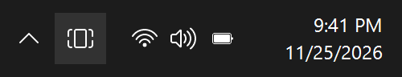
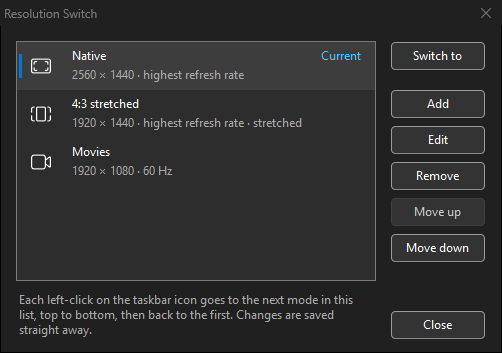
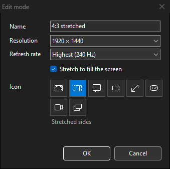

# Resolution Switch

> **Resolution Switch is now part of [Nook](https://github.com/Rushzel/nook)**, one app with the same tray icons and a window for every setting. This repository is archived; new versions come out there.

[](https://github.com/Rushzel/resolution-switch/releases/latest)
[](https://github.com/Rushzel/resolution-switch/releases)
[](https://github.com/Rushzel/resolution-switch/actions)

[](LICENSE)

A taskbar icon that switches your screen resolution in one click and keeps your refresh rate where it should be.

<p align="center"></p>

I made it because I play some games stretched at 4:3 and go back to native for everything else. Windows Settings drops my monitor to 60 Hz every time I change the resolution, and the graphics control panel takes forever to open. This does it from the taskbar.

**[Download ResolutionSwitch.exe](https://github.com/Rushzel/resolution-switch/releases/latest/download/ResolutionSwitch.exe)**

## Get it

1. Download `ResolutionSwitch.exe` from the [latest release](https://github.com/Rushzel/resolution-switch/releases/latest).
2. Put it in its own folder, like `%LOCALAPPDATA%\Programs\Resolution Switch`, and run it.
3. It isn't signed, so SmartScreen will warn you. Click **More info**, then **Run anyway**. Or build it yourself, it's one file.

It needs .NET Framework 4.8, which Windows 10 (1903 and later) and Windows 11 already have. The icon shows up in the taskbar corner. If it's hidden, drag it out of the hidden icons arrow.

## Use it

- **Left-click** goes to the next mode in your list. With two modes it's a toggle.
- **Right-click** to pick a mode, open Edit modes, turn on Start with Windows, or exit.
- **Hover** to see the current mode and refresh rate.

The first time it runs, it sets up two modes from your monitor: Native (the largest resolution it lists) and 4:3 stretched (same height, 4:3 width) if your monitor has it.

Every switch uses the highest refresh rate your monitor has for that resolution, unless you pick one. If something else changes the rate, it puts it back.

## Edit modes

Right-click and choose **Edit modes**.

<p align="center"></p>

- **Switch to** changes to the selected mode.
- **Add** or **Edit** a mode: name, resolution, refresh rate, stretch and icon. The lists only show what your monitor supports.
- **Remove**, **Move up** and **Move down**. The order is the order left-click goes through.

Changes save right away.

<p align="center"></p>

## The modes file

Your modes live in `%APPDATA%\Resolution Switch\modes.txt`, one per line, if you'd rather edit them by hand or share them:

```
Native | 2560x1440
Stretched | 1920x1440 | 144 Hz | stretch | icon game
```

- The refresh rate, `stretch` and `icon` are optional, in any order.
- No rate means the highest. No icon means screen corners, or stretched sides for stretched modes.
- Icons: `corners`, `sides`, `monitor`, `laptop`, `fullscreen`, `game`, `video`, `windows`.
- A line it can't read is skipped, and a notification tells you which one.
- Delete the file to get the defaults back.

## Start with Windows

Tick it in the right-click menu. It adds a `ResolutionSwitch` value under `HKCU\Software\Microsoft\Windows\CurrentVersion\Run`, and unticking removes it. If you move the exe, tick it again.

## Limits

- Primary display only.
- It can only use resolutions your driver lists. On some monitors, stretch only works once scaling is set to the GPU in your graphics control panel.
- Native is the largest listed resolution. With NVIDIA DSR or AMD VSR on, that can be a virtual one. Just edit the line.

## Build it yourself

No Visual Studio needed, the compiler comes with Windows.

```
git clone https://github.com/Rushzel/resolution-switch
cd resolution-switch
.\build.ps1
```

That builds the exe and runs the self-test. There are two built-in checks:

- `.\ResolutionSwitch.exe --self-test | Write-Output` tests the file reader and the defaults without touching your screen.
- `.\ResolutionSwitch.exe --check | Write-Output` asks Windows whether every mode in your file would work, without switching.

GitHub Actions builds every push, and a tag like `v1.1.0` publishes a release.

## License

[MIT](LICENSE)
